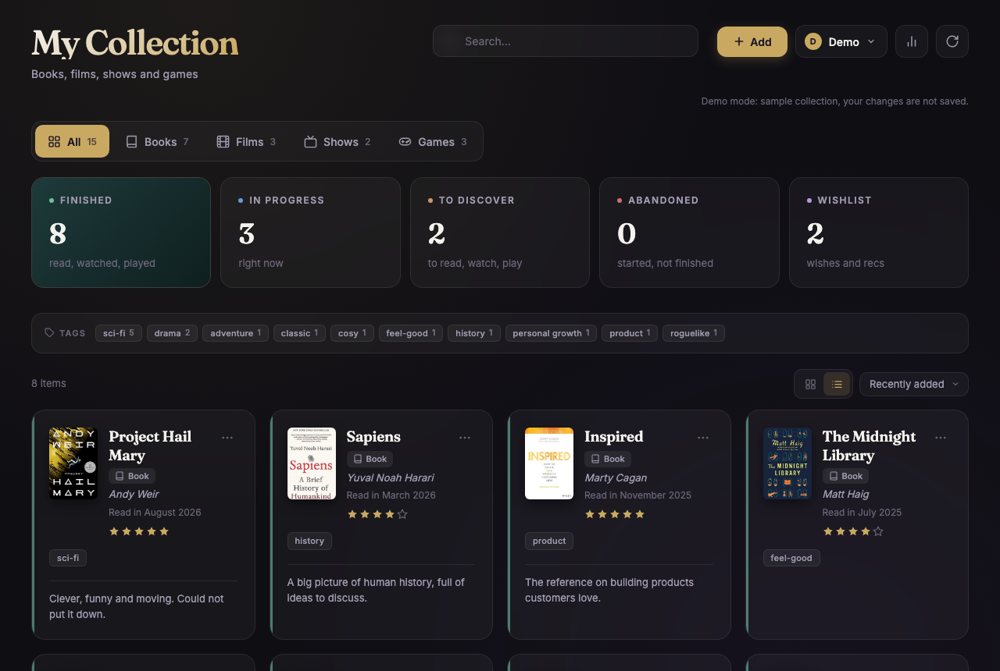
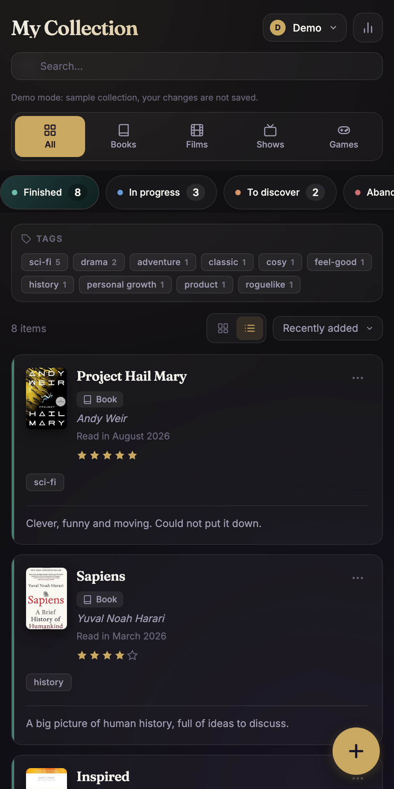

# My Collection

**Live app: [marl75.github.io/mes-livres](https://marl75.github.io/mes-livres/)** · available in English and French

**Try it without an account: [demo mode](https://marl75.github.io/mes-livres/?demo&lang=en)** (sample collection, nothing is saved)

 

A progressive web app to keep track of everything you read, watch and play: books, films, TV shows and video games, in one place.

## Features

- **AI recommendations**: personalised suggestions by Claude based on your collection (✨ button), with "Inspired by" explanations; titles you dismiss are remembered
- **One collection, four types**: books, films, shows and games, each sorted into categories (finished, in progress, to discover, wishlist, abandoned), with free-form notes on wishlist items
- **Choose what you track**: each profile picks its sections on first use or later in "My collections"; hidden sections keep their items, and with a single section the tabs disappear
- **Autofill**: search by title, author or ISBN and the app fills in the details and cover (Open Library, Google Books, TMDB, RAWG)
- **Barcode scanning**: point the phone camera at a book's barcode to add it
- **Where to watch**: streaming availability for films and shows (JustWatch)
- **Add from anywhere**: share a link from another app on your phone straight into the collection
- **Duplicate detection** when adding something you already have
- **Sharing**: create a read-only link to all or part of your collection, with or without your ratings and reviews
- **Statistics and yearly goals** per type, plus a **year in review** (favourites, month by month, themes)
- **Synced across devices**, with export and import of backups
- **Works offline**: changes made without a connection are synced automatically later

## Stack

- Plain HTML, CSS and JavaScript, no build step
- Demo mode with `?demo` in the address (`js/demo.js`): sample data, no account, nothing saved
- Language follows the browser; `?lang=en` or `?lang=fr` in the address forces it
- [Firebase](https://firebase.google.com/) Authentication and Firestore, with security rules in `firestore.rules`
- Firebase Cloud Functions (`functions/`) call the Claude API for recommendations; the Anthropic key stays on the server
- Service worker (`sw.js`) for offline use, web app manifest for installation on a phone
- Usage statistics per account for the owner, shown on the shared admin page [marl75.github.io/admin](https://marl75.github.io/admin/) (`admin.html` redirects there), described in the privacy policy (`privacy-policy.html`)

## Run locally

Serve the folder with any static server, for example `python3 -m http.server 8000`, then open http://localhost:8000.
